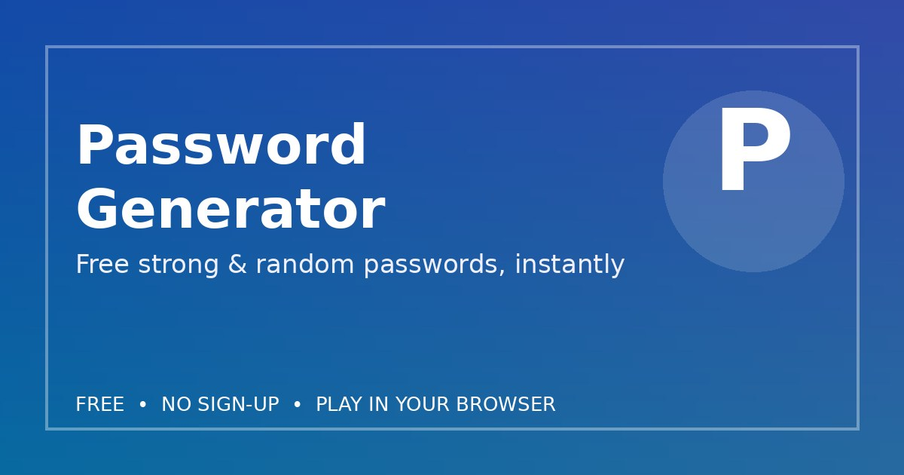

# Password Generator

Generate free strong, random passwords online - length 6-64, symbols, numbers and presets. All in your browser, nothing is stored.

**Live site:** https://password-generator-free.vercel.app/
**GitHub repo:** https://github.com/flutterlive/password-generator
**Language:** English only
**Cost:** Free, no sign-up, no payment

## What this site does

Password generator (length 6-64, toggles, presets, strength meter), English only, Rehman Flutter contact card. Note: AdSense-preparation edit exists in artifact only, not pushed live - no AdSense added in this OG update.

## How to run this project

This is a complete, static web project - no build step, no server, no Python and nothing to install.

1. Download or clone this repository.
2. Open `index.html` directly in any modern browser (Chrome, Edge, Firefox or Safari), or serve the folder with any static host.
3. That is all - the tool/game runs entirely in your browser.

### Serve it on a static host (optional)

- **GitHub Pages:** Settings > Pages > Deploy from a branch > main > root, then open the Pages URL.
- **Vercel:** Import https://github.com/flutterlive/password-generator in Vercel, keep the defaults (no build command, output is the repository root), Deploy. Every push to `main` redeploys automatically.
- **Netlify:** Drag and drop this folder, or connect the repository and deploy with no build command.

### Files in this project

- `index.html` - the complete site (HTML, CSS and JavaScript in one file)
- `assets/og-image.jpg` - the 1200x630 link preview image used by Open Graph / Twitter cards
- `README.md` - this file

Best scores and tool state (where applicable) are saved in the browser's localStorage on the visitor's own device. No data is sent to a server by this page.

